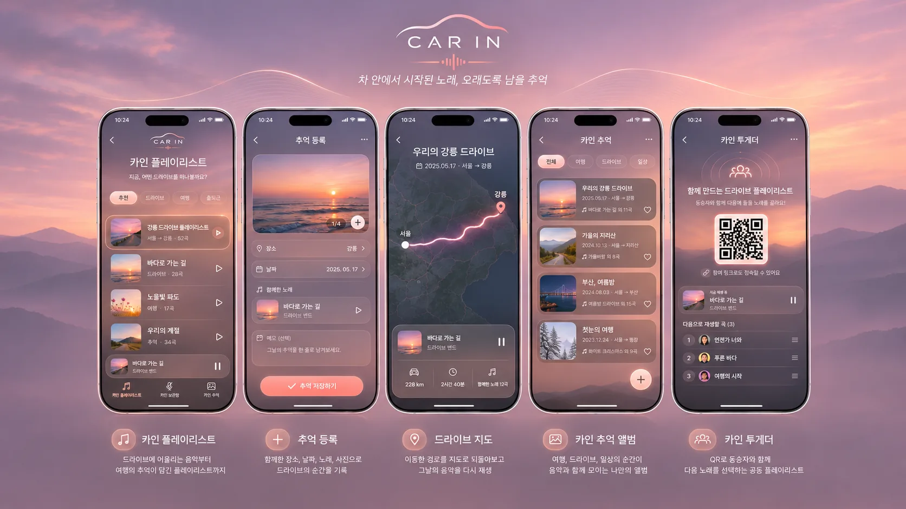
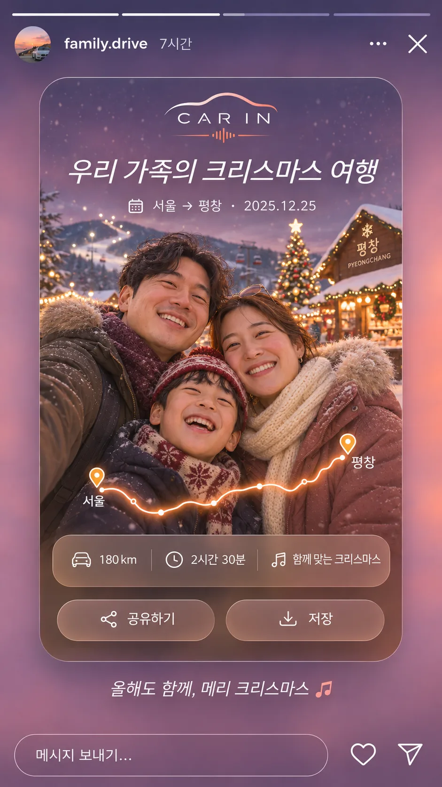

# CAR IN (카인)

> **차 안에서 시작된 노래, 오래도록 남을 추억.**


CAR IN은 **자동차의 목적지와 사용자가 남긴 음악 기록을 연결하는 차량용 음악 서비스**입니다. 다시 찾은 여행지를 향해 출발하면 그날 함께 들었던 노래를 제안하고, 새로운 이동의 순간은 사진·장소·음악과 함께 추억으로 남깁니다.

현대자동차그룹 **Pleos Connect 차량용 앱 개발 공모전** 출품 프로젝트입니다. 이 저장소에는 핵심 경험을 직접 시연할 수 있는 Android MVP가 들어 있습니다.

> 위 이미지는 서비스 방향을 보여 주는 **디자인 시안**입니다. 실제 앱 화면과 구현 범위는 아래의 기능 현황을 기준으로 확인해 주세요.

## 우리가 만들고 싶은 경험

**노래를 듣고서 추억을 떠올리는 데서 한 걸음 더 나아가, 다시 찾은 장소가 추억의 노래를 먼저 들려줍니다.**

지난 추석 고향으로 향하며 들었던 노래를 다음 명절에 다시 만나고, 오래전 강릉 여행의 음악을 같은 목적지로 향하는 길에서 다시 듣습니다. 음악을 들으며 만든 새로운 추억은 기록으로 남아 다음 여행에서 다시 발견됩니다.

| 경험 | 서비스 구상 | 현재 MVP |
| --- | --- | --- |
| **카인 플레이리스트** | 목적지에 연결된 노래를 다시 제안하는 **Memory Route** | 음악 재생, 추억과 목적지 매칭, 해당 곡 재생 구현 |
| **카인 노래방** | 주차·충전 중 함께 즐기는 차량 안 음악 공간 | 주차 상태 확인, 사진 배경, 정적 데모 가사, 음악 재생 구현 |
| **카인 추억** | 여행의 장소·사진·노래를 기록하고 다시 보는 앨범 | 추억 등록·조회·삭제, 사진 연결, 해당 곡 재생 구현 |
| **CAR IN Together** | 동승자가 휴대폰으로 함께 선곡하는 경험 | 향후 연동 예정 |

**지난 추억 듣기 → 함께 새로운 순간 만들기 → 기록하기 → 다음 여행에서 다시 발견하기**가 CAR IN의 전체 서비스 흐름입니다. 현재 MVP는 이 중 **목적지에서 추억의 노래를 다시 듣고 사진과 함께 기록하는 핵심 흐름**에 집중합니다.

## 서비스 디자인



위 화면은 모바일 연동과 여행 앨범까지 포함한 **전체 서비스 디자인 시안**입니다. 현재 저장소는 Pleos Connect 차량 앱 중심의 MVP이며, 시안 속 휴대폰 앱·실제 이동 경로·거리와 시간 통계·QR 공동 선곡·공유 기능은 구현되지 않았습니다.

<details>
<summary><strong>향후 확장 콘셉트 이미지 보기</strong></summary>

### 여행 기록 공유



여행 사진과 이동 기록, 그날의 음악을 함께 담은 **Drive Story 공유 시안**입니다. 이미지 속 SNS 업로드와 경로·거리·시간 기록은 현재 앱 기능이 아닙니다.

### 충전 중 카인 노래방


차량을 충전하는 동안 호환 마이크, 에코 효과, 엠비언트 라이트와 함께 노래하는 **향후 확장 시안**입니다. 현재 MVP에는 마이크 입력·에코·조명 제어·MR·점수 기능이 없습니다.

</details>

## 현재 동작하는 MVP

- **음악 감상:** Media3 ExoPlayer로 곡 선택, 재생·일시정지, 이전·다음 곡과 미니 플레이어를 제공합니다.
- **Memory Route:** 사용자가 장소·제목·날짜·곡을 등록하면, 목적지와 장소를 비교해 과거 기록을 제안하고 연결된 곡을 실제로 재생합니다. 동일 목적지의 기록은 최근 여행부터 보여 줍니다.
- **카인 추억:** 기록 목록·상세·삭제, 사진 연결, 추억 사진을 배경으로 한 노래방 진입을 지원합니다. 기록은 앱 재실행 후에도 유지됩니다.
- **사진 처리와 보존:** 새 사진을 백그라운드에서 크기 확인·축소·EXIF 방향 보정 후 JPEG로 저장합니다. 저장 실패 시 기존 연결을 유지하고, 복원용 데이터가 참조하는 사진은 삭제하지 않습니다.
- **손상 데이터 보호:** 저장 데이터가 손상되면 원문을 백업합니다. 전체를 읽을 수 없을 때 쓰기를 차단하고, 일부 기록만 읽지 못할 때는 해당 원문을 보존합니다.
- **카인 노래방 체험:** 주차 확인 후 사진 또는 기본 배경과 정적 데모 가사를 보여 줍니다. 기존 음악 플레이어와 재생 상태를 공유합니다. **가사는 곡과 시간 동기화되지 않습니다.**
- **주행 안전:** 음악 재생은 이용할 수 있으며, 추억 등록·삭제·사진 선택·노래방은 `CarUxRestrictions` 조회 결과가 주차일 때만 허용하도록 구현했습니다.

### 시연에서 사용하는 대체 입력과 검증 범위

NaviHelper SDK 연결과 목적지 조회 호출은 확인했습니다. 다만 에뮬레이터에서 실제 내비게이션 목적지를 설정할 수 없어, **`[DEMO]`가 표시되는 데모 목적지 선택**으로 장소 매칭을 시연합니다. SDK에서 목적지가 제공되면 그 값을 우선 사용합니다.

Pleos Connect Emulator에서 등록·재생·사진 연결·앱 재실행 및 덮어 설치 후 데이터 유지, 손상 데이터 보호 상태, 직전 기록과 사진의 복원을 확인했습니다. **실제 차량의 목적지 데이터와 주행 중 기능 차단은 아직 검증하지 않았습니다.**

## 3분 시연 흐름

1. 앱을 실행하고 미니 플레이어에서 음악을 재생합니다.
2. **추억 등록**에서 장소 `강릉`과 노래를 저장하거나 데모 데이터를 만듭니다.
3. **데모 목적지 선택 → 강릉역**을 선택합니다. 화면에 `[DEMO]`가 표시됩니다.
4. 메인 카드에서 과거 추억의 노래 제안을 확인하고 **재생하기**를 누릅니다.
5. **카인 추억**에서 기록·사진을 확인하고, 주차 상태에서 **카인 노래방**을 엽니다.

자세한 순서는 [시연 안내](docs/demo-guide.md)를 참고하세요.

## 실행 및 빌드

Pleos Connect 개발 환경과 SDK 저장소 설정을 마친 뒤 프로젝트 루트에서 실행합니다. **이 저장소에는 설치용 APK가 포함되어 있지 않습니다.**

```bash
./gradlew testDebugUnitTest
./gradlew assembleDebug
adb install -r app/build/outputs/apk/debug/app-debug.apk
adb shell am start -n com.carin.noraebang/.MainActivity
```

Windows PowerShell에서는 `./gradlew` 대신 `./gradlew.bat`을 사용하세요. Release 빌드는 `./gradlew assembleRelease`로 만들 수 있지만, **서명된 APK가 필요하다면** 저장소에 포함되지 않은 `keystore.properties`를 먼저 설정해야 합니다. 형식은 [`keystore.properties.example`](keystore.properties.example)을 참고하세요.

| 항목 | 개발 환경 |
| --- | --- |
| 언어·앱 ID | Java 11 · `com.carin.noraebang` |
| Android | compileSdk 37 · targetSdk 37 · minSdk 28 |
| 음악 | Media3 ExoPlayer·Session 1.11.1 |
| 차량·내비 SDK | Pleos Vehicle 2.3.2 · NaviHelper 3.0.5 |
| 확인한 환경 | Pleos Connect Emulator v2.1.0, Android 14(API 34) |

## 다음 개발 단계

| 순서 | 계획 | 현재 상태 |
| --- | --- | --- |
| 1 | 백그라운드 재생과 앱 복귀 시 플레이어 상태 안정화 | 미구현 |
| 2 | 실제 목적지 데이터·주행 제한 검증, 주행 상태 변화 대응 | 실차 검증 필요 |
| 3 | 추억 삭제·기본 배경 전환 시 불필요한 사진 정리 | 미구현 |
| 4 | Drive Story의 경로·시간 기록과 이미지 공유, 휴대폰 연동 | 향후 연동 예정 |
| 5 | QR 공동 선곡, 마이크·에코·가사 동기화·MR, 엠비언트 라이트 | 파트너십·기기/SDK 호환성 확인 후 검토 |

공유 시안의 거리·시간·경로와 마이크·조명 연출은 **미래 경험을 설명하는 예시**이며 현재 앱에서 생성하거나 제어하는 데이터가 아닙니다. 음악 콘텐츠 이용 권리와 차량 시스템 호환성도 서비스 확대 단계에서 확인해야 합니다.

## 프로젝트 구조와 문서

| 경로 | 역할 |
| --- | --- |
| `app/src/main/java/com/carin/noraebang/MainActivity.java` | 메인 화면·플레이어·추억·노래방 흐름 |
| `app/src/main/java/com/carin/noraebang/memory/` | 추억 저장, 장소 매칭, 손상 보호와 사진 보존 |
| `app/src/main/java/com/carin/noraebang/photo/` | 사진 크기·방향 보정과 JPEG 저장 |
| `app/src/main/java/com/carin/noraebang/karaoke/` | 노래방 화면과 사진 선택 |
| `app/src/main/java/com/carin/noraebang/navi/`, `safety/` | 목적지 조회와 주행 안전 확인 |
| `app/src/main/assets/backgrounds/` | 앱에 포함된 기본 JPEG 배경 |
| `docs/images/` | README용 디자인·확장 콘셉트 시안 |

기획과 구현을 더 자세히 보려면 [기능 현황](docs/feature-status.md), [구현 요약](docs/implementation-summary.md), [초기 감사 기록](docs/mvp-audit.md)을 참고하세요. 이미지 시안과 실제 구현은 위의 **현재 동작하는 MVP** 및 소스 코드를 기준으로 구분해 주세요.
