# CAR IN (카인)

<picture>
  <source media="(prefers-color-scheme: dark)" srcset="docs/images/carin-logo-dark.png">
  
</picture>

> **차 안에서 시작된 노래, 오래도록 남을 추억.**
> Drive with Music, Remember with Places.

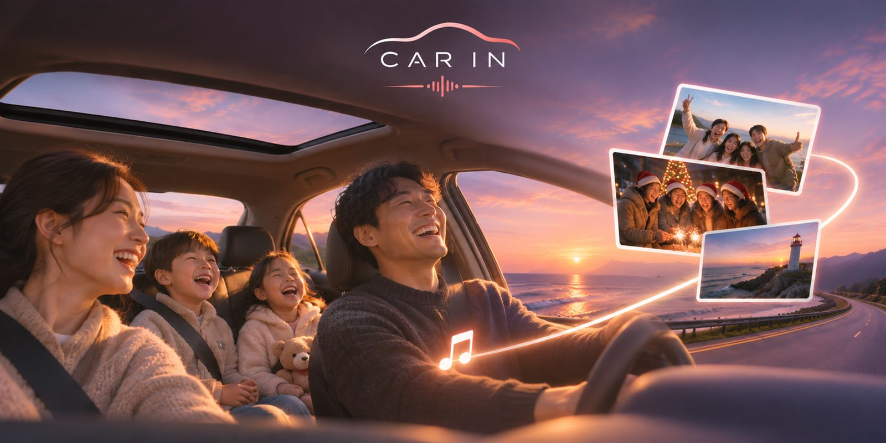

CAR IN은 **다시 찾은 길이 그날의 노래를 먼저 들려주는 차량용 음악 서비스**입니다. 여행지에서 함께 들은 노래를 장소·날짜·사진과 함께 남겨 두면, 다음에 같은 목적지로 출발할 때 차가 그 노래를 다시 꺼내 줍니다.

현대자동차그룹 **Pleos Connect 차량용 앱 개발 공모전** 출품작이며, 이 저장소에는 Pleos Connect 에뮬레이터에서 동작하는 Android MVP가 들어 있습니다.

<br>

## 기획 배경

### 노래는 기억을 데려오지만, 기억은 노래를 찾지 못한다

어떤 노래를 우연히 다시 들으면 그 노래를 듣던 길, 함께 탔던 사람, 창밖 풍경까지 한꺼번에 떠오릅니다. 그런데 반대 방향은 잘 되지 않습니다. 몇 년 만에 같은 바다로 향하면서 "그때 차에서 무슨 노래 들었더라?"를 떠올리기는 어렵습니다.

차 안은 이런 기억이 가장 많이 생기는 곳입니다. 가족이 명절에 고향으로 가는 길, 친구들과 떠난 여름 바다, 연인과의 첫 여행에서 음악은 늘 배경으로 흐릅니다. 하지만 그 순간이 지나고 나면 기록은 흩어집니다.

| 흩어진 기록 | 남는 곳 | 그래서 생기는 일 |
| --- | --- | --- |
| 함께 들은 노래 | 스트리밍 재생 기록 속 수많은 곡 중 하나 | 어느 여행의 노래였는지 알 수 없음 |
| 여행 사진 | 휴대폰 갤러리 | 사진은 있지만 그날의 소리는 없음 |
| 다녀온 장소 | 내비게이션 최근 목적지 | 다시 가도 아무것도 떠올려 주지 않음 |

### 차는 "어디로 가는지" 먼저 알고 있다

휴대폰 음악 앱은 지금 어디로 가는지 모릅니다. 하지만 차는 **출발하기 전에 목적지를 알고**, 운전자는 운전 중에 노래를 찾아 고를 수 없습니다. CAR IN은 이 점에서 출발했습니다.

- **목적지가 열쇠가 됩니다.** 내비게이션 목적지가 과거 여행지와 같으면, 운전자가 아무것도 찾지 않아도 그날의 노래를 먼저 제안합니다.
- **기록은 차가 멈췄을 때 합니다.** 추억 등록, 사진 연결, 노래방은 주차 상태에서만 열립니다. 주행 중에는 음악만 듣습니다.
- **기억은 한 사람의 것이 아닙니다.** 같은 차에 탔던 가족, 친구, 연인이 같은 길에서 같은 노래를 다시 만납니다.

<table>
  <tr>
    <td align="center" width="33%"><br><b>가족</b><br>크리스마스에 평창으로 가던 길의 캐럴을 다음 겨울에 다시</td>
    <td align="center" width="33%">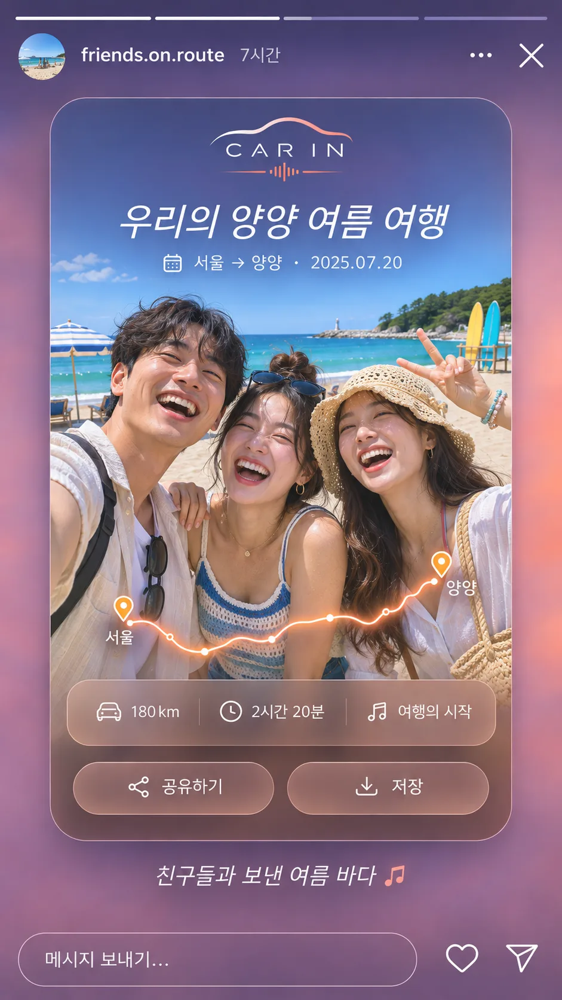<br><b>친구</b><br>양양 바다로 달리며 다 같이 부르던 노래를 다음 여름에 다시</td>
    <td align="center" width="33%">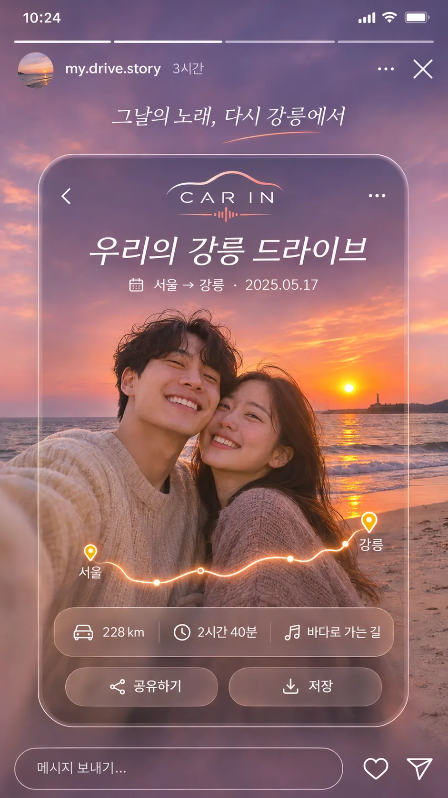<br><b>연인</b><br>처음 함께 간 강릉의 노래를 기념일 드라이브에서 다시</td>
  </tr>
</table>

<sub>위 이미지는 서비스가 지향하는 경험을 보여 주는 디자인 시안입니다. 이동 거리·시간 기록과 SNS 공유는 향후 기능입니다.</sub>

<br>

## 서비스 흐름

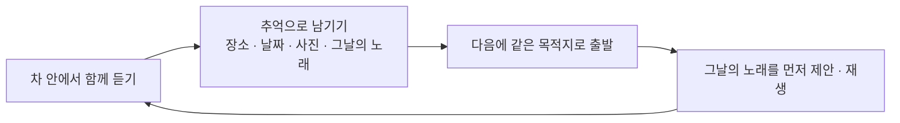

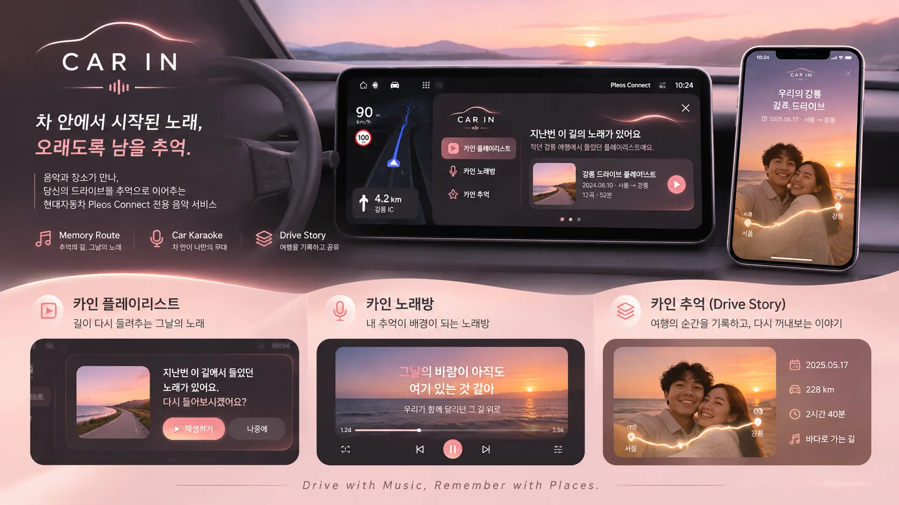

CAR IN은 세 가지 공간으로 이루어져 있습니다.

| | 카인 플레이리스트 | 카인 추억 | 카인 노래방 |
| --- | --- | --- | --- |
| 한 줄 소개 | 길이 다시 들려주는 그날의 노래 | 여행의 음악과 사진을 하나의 이야기로 | 내 추억이 배경이 되는 노래방 |
| 언제 | 출발할 때, 달리는 동안 | 도착해서, 차를 세웠을 때 | 주차·충전하며 기다릴 때 |
| 핵심 | **Memory Route** 목적지 매칭 | 기록 등록·조회·사진 연결 | 추억 사진 배경 + 가사 화면 |

<br>

## 주요 기능

### 1. 카인 플레이리스트: Memory Route

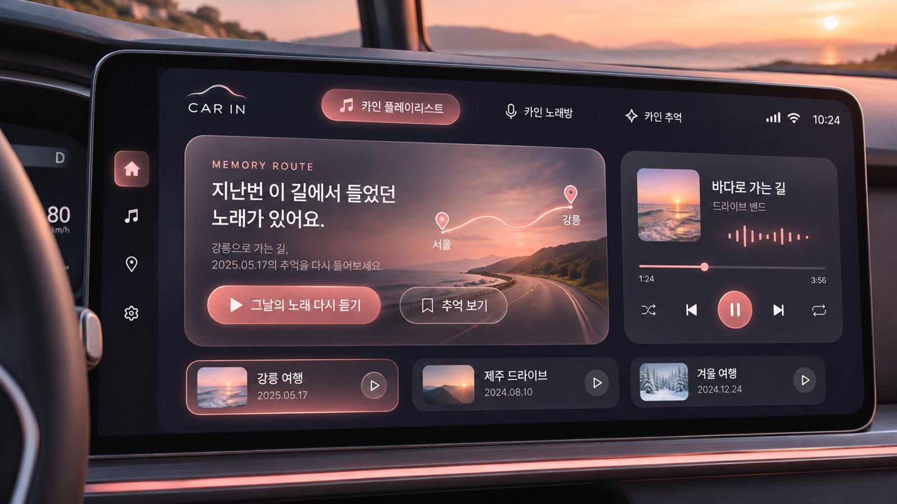

목적지를 정하면 CAR IN이 저장된 추억 중 같은 지역의 기록을 찾습니다. 찾으면 메인 카드가 **"지난번 이 길에서 들었던 노래가 있어요. 다시 들어보시겠어요?"** 로 바뀌고, **재생하기**를 누르면 그날 연결해 둔 곡이 바로 재생됩니다.

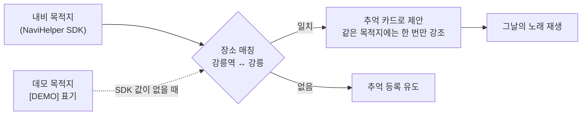

- **지역 단위 매칭:** "강릉역", "강원특별자치도 강릉시 …" 모두 "강릉" 추억과 이어집니다. 글자 일부만 겹치는 경우("산" ↔ "부산")는 연결하지 않습니다.
- **같은 곳의 추억이 여럿이면** 최근 여행부터 보여 주고 카드에서 넘겨 볼 수 있습니다.
- **백그라운드 재생:** 홈이나 내비 화면으로 넘어가도 음악이 계속 나오고, 차량 미디어 키와 앱의 재생 상태가 일치합니다.

<table>
  <tr>
    <td><b>실제 앱 화면</b> · Pleos Connect 에뮬레이터에서 데모 목적지 <code>[DEMO] 강릉역</code>을 선택한 모습</td>
  </tr>
  <tr>
    <td>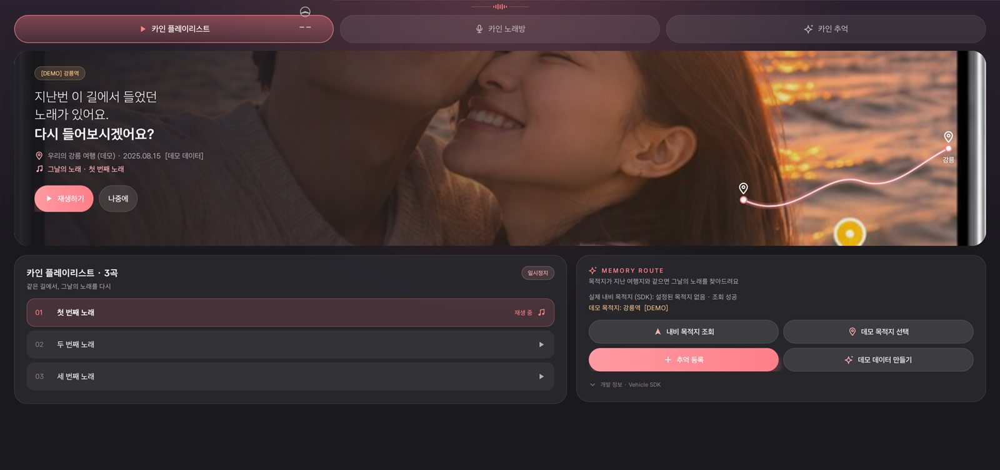</td>
  </tr>
</table>

### 2. 카인 추억: 노래가 있는 여행 앨범

<table>
  <tr>
    <td align="center" width="50%">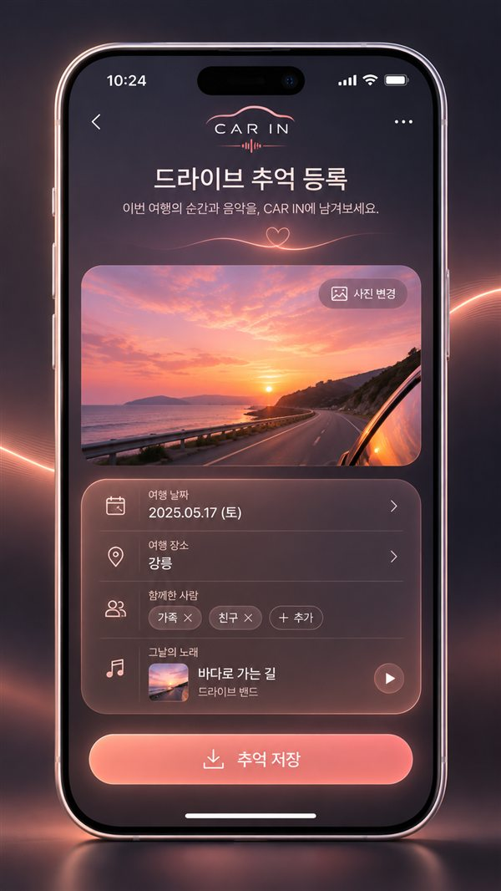<br>여행 날짜·장소·사진과 <b>그날의 노래</b>를 함께 남깁니다</td>
    <td align="center" width="50%">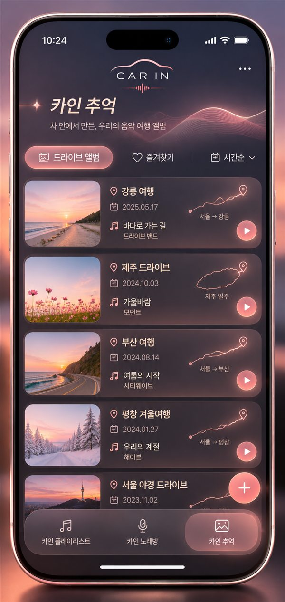<br>모든 기록이 노래와 함께 앨범으로 쌓입니다</td>
  </tr>
</table>

여행의 장소, 날짜, 사진, 그리고 그때 들은 노래를 하나의 추억으로 묶습니다. 카드나 상세 화면에서 **그날의 노래**를 바로 재생할 수 있고, 추억 사진을 배경으로 노래방에 들어갈 수도 있습니다.

- 사진은 앱 안에 복사해 보관하므로 원본이 지워져도 추억에서 사라지지 않습니다. 큰 사진은 자동으로 줄이고 방향을 맞춥니다.
- 저장 데이터가 손상되더라도 원본을 덮어쓰지 않고 백업해, 기록을 잃지 않도록 보호합니다.

<table>
  <tr>
    <td><b>실제 앱 화면</b> · 추억 상세 (사진 · 날짜 · 장소 · 그날의 노래 · 노래방 진입)</td>
  </tr>
  <tr>
    <td>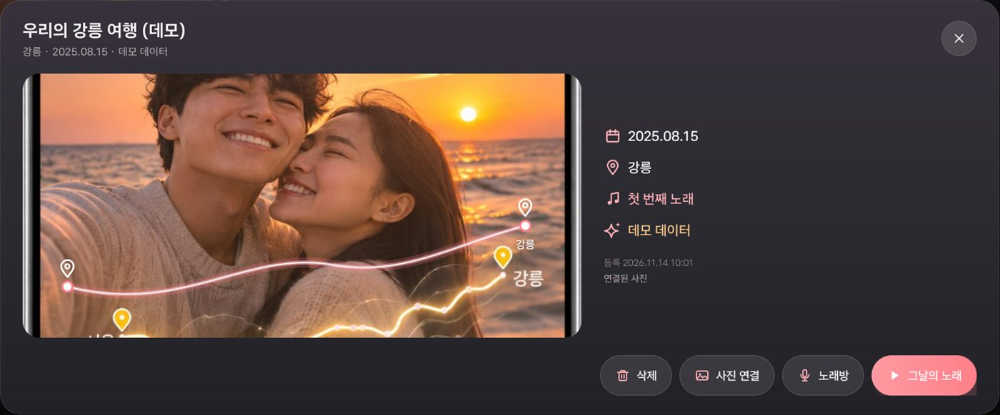</td>
  </tr>
</table>

### 3. 카인 노래방: 기다리는 시간을 함께 부르는 시간으로

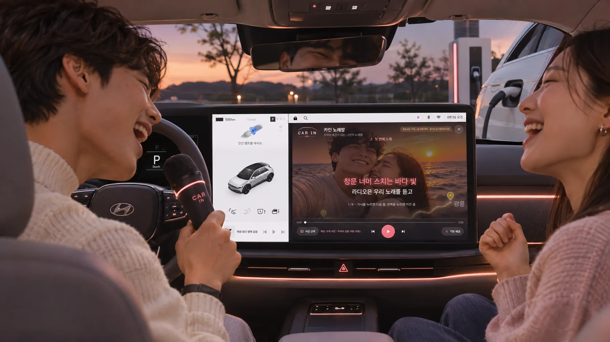

충전을 기다리거나 휴게소에 잠시 섰을 때, 차 안이 작은 노래방이 됩니다. 지금 재생 중인 곡과 연결된 **추억 사진이 배경**으로 깔리고 가사 화면이 나타납니다. 노래방은 같은 화면 위에 열리기 때문에 듣던 음악이 끊기지 않습니다.

<table>
  <tr>
    <td><b>실제 앱 화면</b> · 추억 사진 배경 + 데모 가사 (주차 상태에서만 진입)</td>
  </tr>
  <tr>
    <td>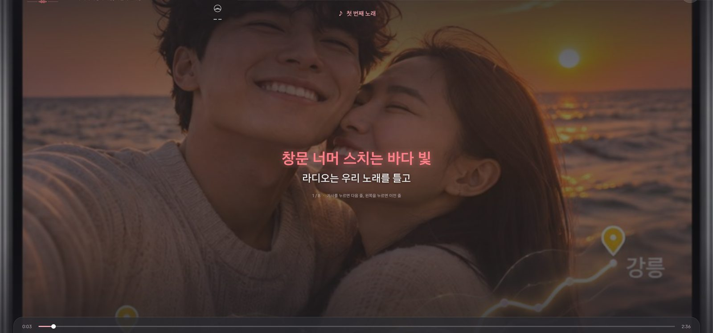</td>
  </tr>
</table>

<sub>현재 가사는 팀이 직접 만든 정적 데모 가사이며 곡과 시간 동기화되지 않습니다. 마이크 입력, 에코, 조명 연출은 향후 기능입니다.</sub>

### 4. CAR IN Together (향후)

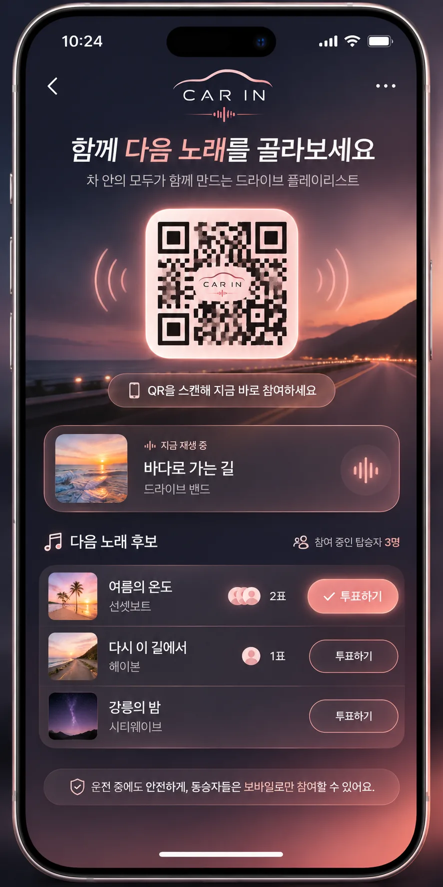

운전자는 운전에만 집중하고, 동승자는 각자의 휴대폰에서 QR로 참여해 다음 노래를 함께 고릅니다. 가족 여행에서는 아이들이, 친구 여행에서는 모두가 플레이리스트를 함께 만듭니다.

<sub>QR 연결, 휴대폰 연동, 투표는 2차 개발 범위입니다.</sub>

<br clear="right">

<br>

## 차량 앱으로서의 설계

| 원칙 | 구현 |
| --- | --- |
| 운전 중에는 듣기만 | 추억 등록·삭제, 사진 선택, 노래방은 `CarUxRestrictions` 결과가 **주차**일 때만 엽니다. 화면이 보이는 동안 주행 상태 변화를 실시간으로 받아, 주행이 시작되면 열려 있던 노래방·추억 입력 창을 바로 닫습니다. 상태를 확인할 수 없을 때도 제한합니다. 음악 재생은 언제나 가능합니다. |
| 운전자가 찾지 않아도 | 목적지(NaviHelper SDK)만으로 추억을 찾아 제안합니다. 같은 목적지에서는 한 번만 강조해 반복 알림이 없습니다. |
| 차량 미디어와 하나로 | Media3 `MediaLibraryService`가 플레이어를 소유합니다. 앱 밖에서도 재생이 이어지고 시스템 미디어 키·재개 요청을 따릅니다. 앱을 켜는 것만으로 자동 재생하지 않습니다. |
| 실제와 데모를 구분 | 실제 내비 목적지는 `(SDK)`, 시연용 목적지는 `[DEMO]`로 화면에 항상 표시합니다. |
| Pleos 화면 가이드 | 가로 창과 세로 분할 창(약 840dp) 모두에 맞춰 배치합니다. 글자·아이콘 대비는 4.5:1 이상, 로터리·방향키로 옮긴 포커스는 테두리로 표시합니다. 뒤로 가기는 앱을 끝내지 않고 숨겨 음악이 이어집니다. |

<br>

## 현재 구현 범위

이 README의 시안 이미지는 서비스 방향을 설명하기 위한 것입니다. 실제 동작은 **"실제 앱 화면"** 으로 표시한 에뮬레이터 캡처와 아래 표를 기준으로 봐 주세요.

| 기능 | 상태 | 비고 |
| --- | --- | --- |
| 음악 재생 · 미니 플레이어 · 백그라운드 재생 | ✅ 구현 | 차량 미디어 세션·미디어 키 연동 확인 |
| Memory Route 목적지 매칭 · 그날의 노래 재생 | ✅ 구현 | 장소 매칭 단위 테스트 포함 |
| NaviHelper 목적지 조회 | 🟡 연결 확인 | 에뮬레이터에 실제 목적지를 설정할 수 없어 `[DEMO]` 목적지로 시연 |
| 카인 추억 등록·조회·삭제 · 사진 연결 | ✅ 구현 | 앱 재실행·덮어 설치 후에도 기록과 사진 유지. 지우거나 바꾼 사진은 복원 여지를 둔 뒤 정리 |
| 카인 노래방 (사진 배경 · 데모 가사) | ✅ 구현 | 가사 시간 동기화·마이크·MR은 미구현 |
| 주행 중 기능 제한 · 주행 시작 시 자동 닫힘 | 🟡 구현, 실차 검증 필요 | 에뮬레이터에서 주행 상태를 만들 수 없어 debug 주입으로 닫힘 경로만 확인 |
| 세로 분할 창 · 로터리 포커스 | ✅ 구현 | 에뮬레이터 분할 창·방향키로 확인. 실차 로터리 노브는 미검증 |
| Drive Story (경로·거리·시간 기록, 공유) | 🗓 향후 | GPS 기록·SNS 공유 범위 밖 |
| CAR IN Together (QR 공동 선곡) | 🗓 향후 | |

<br>

## 3분 시연 흐름

1. 앱을 실행하고 음악을 재생합니다.
2. **데모 데이터 만들기**로 강릉 추억을 만들거나, **추억 등록**에서 장소 `강릉`과 노래를 저장합니다.
3. **데모 목적지 선택 → 강릉역**을 고릅니다. 화면에 `[DEMO]`가 표시됩니다.
4. 메인 카드의 "지난번 이 길에서 들었던 노래가 있어요"에서 **재생하기**를 누릅니다.
5. **카인 추억**에서 기록과 사진을 확인하고, 상세 화면에서 **노래방**을 엽니다.

자세한 순서는 [시연 안내](docs/demo-guide.md)를 참고하세요.

<br>

## 실행 및 빌드

바로 설치할 수 있는 제출 APK는 [`apk/CARIN_CAR_IN_release.apk`](apk/CARIN_CAR_IN_release.apk) (15.5 MB)입니다.

```bash
./gradlew testDebugUnitTest      # 단위 테스트
./gradlew assembleDebug
adb install -r app/build/outputs/apk/debug/app-debug.apk
adb shell am start -n com.carin.noraebang/.MainActivity
```

Windows PowerShell에서는 `./gradlew.bat`을 사용하세요. 서명된 Release APK(`./gradlew assembleRelease`)가 필요하면 저장소에 포함되지 않은 `keystore.properties`를 먼저 설정해야 합니다. 형식은 [`keystore.properties.example`](keystore.properties.example)을 참고하세요.

| 항목 | 개발 환경 |
| --- | --- |
| 언어 · 앱 ID | Java 11 · `com.carin.noraebang` |
| Android | compileSdk 37 · targetSdk 37 · minSdk 28 |
| 음악 | Media3 ExoPlayer · Session 1.11.1 |
| 차량 · 내비 SDK | Pleos Vehicle 2.3.2 · NaviHelper 3.0.5 |
| 확인한 환경 | Pleos Connect Emulator v2.1.0, Android 14 (API 34) |

<br>

## 다음 단계

| 순서 | 계획 | 상태 |
| --- | --- | --- |
| 1 | 실제 내비 목적지·주행 제한·로터리 노브 실차 검증 | 실차 검증 필요 |
| 2 | Media Center 템플릿 적용(미디어 라이브러리 노출·Tune Knob·Media 버튼), 스티어링 휠 하드키 | Pleos 템플릿 제공 여부 확인 후 |
| 3 | 이전 버전이 남긴 사진 파일 일괄 정리 | 미구현 |
| 4 | Drive Story: 경로·거리·시간 기록과 이미지 공유, 휴대폰 연동 | 향후 |
| 5 | CAR IN Together, 가사 동기화·MR·마이크, 엠비언트 라이트 연출 | 파트너십·기기 호환성 확인 후 |

음악 콘텐츠 이용 권리와 차량 시스템 호환성은 서비스 확대 단계에서 함께 확인해야 합니다. 현재 앱에는 팀이 준비한 음원 3곡만 들어 있습니다.

<br>

## 프로젝트 구조와 문서

| 경로 | 역할 |
| --- | --- |
| `app/src/main/java/com/carin/noraebang/MainActivity.java` | 메인 화면 · 플레이어 · Memory Route · 노래방 흐름 |
| `.../memory/` | 추억 저장, 장소 매칭, 손상 보호와 사진 보존 |
| `.../playback/` | 백그라운드 재생 서비스(MediaLibraryService) · 차량 탐색용 플레이리스트 |
| `.../karaoke/` | 노래방 화면과 사진 선택 |
| `.../photo/` | 사진 크기 · 방향 보정과 JPEG 저장 |
| `.../navi/`, `.../safety/` | 목적지 조회와 주행 안전 확인 |
| `.../ui/` | 브랜드 팔레트 · 아이콘 · 다이얼로그 등 디자인 시스템 |
| `docs/images/` | README 이미지 (`screens/`는 실제 앱 캡처, `source/`는 팀 제공 시안 원본) |

더 자세한 내용은 [기능 현황](docs/feature-status.md), [구현 요약](docs/implementation-summary.md), [시연 안내](docs/demo-guide.md)를 참고하세요.
